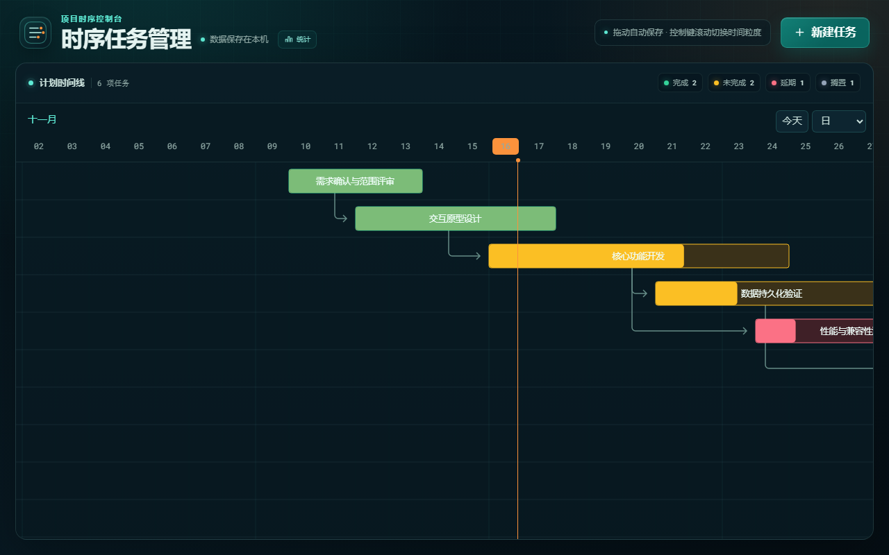
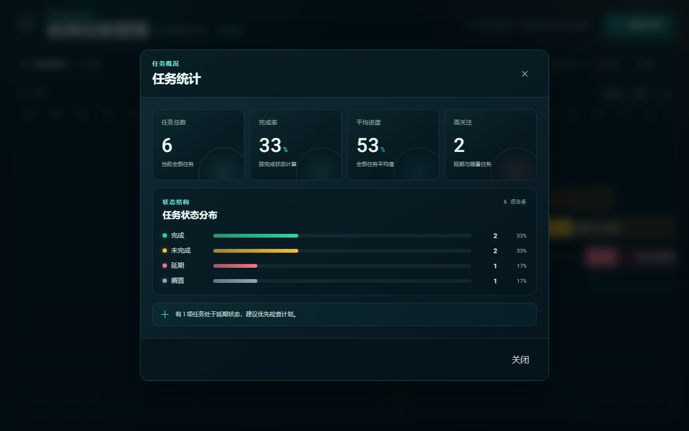

<div align="center">


# 时序任务管理

**面向本机项目计划的桌面任务时序与进度管理工具**

以甘特图组织任务、依赖关系、状态与进度，数据完整保存在本地 SQLite 中。

[](https://tauri.app/)
[](https://www.rust-lang.org/)
[](https://www.sqlite.org/)
[](https://developer.mozilla.org/docs/Web/JavaScript)

</div>

## 界面预览

<div align="center">



<sub>任务甘特图、状态统计与时间粒度控制</sub>

</div>

## 产品定位

时序任务管理是一款轻量的单机桌面应用，面向需要规划任务时间、跟踪进度和维护依赖关系的个人与小型项目。

应用采用 Tauri 2 构建，不依赖远程服务。任务数据、状态、依赖关系和时间安排均保存在本机 SQLite 数据库中。

## 核心能力

### 任务时序管理

通过甘特图直观查看任务时间范围，拖动任务条即可调整计划。支持时间轴横向扩展，并可浏览任务日期之前和之后的时间范围。

### 多状态跟踪

任务支持四种状态，并在甘特图中使用一致的颜色标识：

| 状态 | 标识色 | 说明 |
|---|---|---|
| 完成 | 绿色 | 已交付任务 |
| 未完成 | 黄色 | 默认状态 |
| 延期 | 红色 | 需要重新评估计划 |
| 搁置 | 灰色 | 暂时停止推进 |

### 依赖关系

任务可以指定一个或多个前置任务。甘特图会绘制依赖连线；删除任务时，系统会同步清理其他任务中的失效依赖。

### 自动保存

拖动日期、修改进度或编辑任务后，数据会自动写入本机 SQLite。写入请求按顺序执行，避免高频操作造成并发覆盖。

### 时间粒度切换

按住控制键滚动鼠标，可在小时、日、周、月、年等时间粒度间切换。切换时尽量保持当前视图中心日期不变。

### 项目统计

点击左上角产品标题可打开任务统计面板，查看任务总数、完成率、平均进度、需关注任务和四种状态的分布。

<div align="center">



<sub>任务状态分布与项目概览</sub>

</div>

## 设计原则

- **本地优先：** 不连接网络服务，不依赖账号或云端数据。
- **数据清晰：** 状态、进度和依赖关系以可视化方式直接呈现。
- **操作直接：** 拖动、编辑和自动保存保持在单一工作窗口内。
- **克制动效：** 启动、弹窗和状态变化使用短促动效，并支持系统“减少动态效果”设置。
- **键盘可用：** 主要操作保留可见焦点和可访问标签。

## 技术架构

```text
┌────────────────────────────────────────────────────────┐
│ 原生 HTML / CSS / JavaScript + 甘特图组件              │
└───────────────────────────┬────────────────────────────┘
                            │ Tauri invoke
┌───────────────────────────▼────────────────────────────┐
│ Rust 数据访问层                                        │
│ 任务查询 · 创建更新 · 日期进度 · 依赖清理             │
└───────────────────────────┬────────────────────────────┘
                            │ rusqlite
┌───────────────────────────▼────────────────────────────┐
│ 本机 SQLite 数据库                                     │
└────────────────────────────────────────────────────────┘
```

## 技术栈

| 层级 | 技术 |
|---|---|
| 桌面容器 | Tauri 2 |
| 桌面后端 | Rust |
| 本地数据库 | SQLite / rusqlite |
| 前端 | 原生 HTML、CSS、JavaScript |
| 构建工具 | Vite |
| 测试 | Vitest、Rust 单元测试 |
| 字体 | Exo、Roboto Mono，本地打包 |

## 开发环境

### 环境要求

- Node.js 20 或更高版本
- Rust 稳定版
- Windows WebView2
- Windows C++ 构建工具

### 安装依赖

```powershell
npm install
```

### 启动开发版

```powershell
npm run tauri dev
```

## 测试与构建

### 前端测试

```powershell
npm test
```

### Rust 数据层测试

```powershell
cd src-tauri
cargo test
```

### 前端生产构建

```powershell
npm run build
```

### Windows 安装包

```powershell
npm run tauri build
```

安装包输出到：

```text
src-tauri/target/release/bundle/nsis/时序任务管理_0.1.0_x64-setup.exe
```

## 本地数据

Windows 环境下的默认数据库位置：

```text
%APPDATA%\com.local.taskmanager\tasks.db
```

备份该文件即可备份全部任务。数据库采用本机轻量结构，不包含账号、角色、授权或云同步数据。

> 升级前建议复制数据库文件。应用升级不会主动覆盖现有数据库。

## 项目结构

```text
.
├── assets/
│   └── screenshots/          # README 界面截图
├── src/
│   ├── chart-config.js       # 甘特图配置与时间粒度
│   ├── index.html            # 应用界面
│   ├── main.js               # 交互与任务流程
│   ├── styles.css            # 全局视觉系统
│   └── task-store.js         # 前端任务数据服务
├── src-tauri/
│   ├── src/db.rs             # SQLite 数据访问
│   ├── src/lib.rs            # Tauri 命令与应用初始化
│   └── tauri.conf.json       # 桌面与安装包配置
├── tests/                    # 前端单元测试
├── package.json
└── vite.config.js
```

## 当前范围

应用以单机、轻量和个人项目规划为核心，当前不包含：

- 账号与登录
- 云端同步
- 多人实时协作
- 通知与日程提醒
- 移动端版本

---

<div align="center">

**时序任务管理 · 在本机完成清晰、可追踪的项目计划**

</div>
